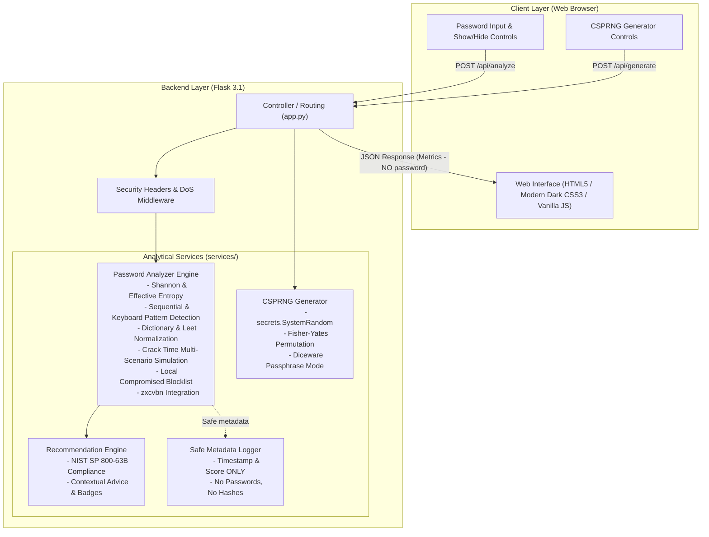

# Advanced Password Strength Analyzer and Security Recommendation System

[](https://www.python.org/)
[](https://palletsprojects.com/p/flask/)
[](https://csrc.nist.gov/pubs/sp/800/63/b/4/final)
[](tests/)
[](#privacy-guarantee--zero-credential-retention)
[](LICENSE)

An educational, enterprise-grade cybersecurity web application that conducts in-depth, privacy-preserving password strength assessments. It calculates information-theoretic Shannon entropy, detects sequential patterns, keyboard walks, dictionary stems, and leet-speak mutations, simulates cracking resistance across four adversarial attack profiles, and generates NIST SP 800-63B-compliant recommendations and cryptographically secure passwords.

---

## 📌 Table of Contents
- [Project Overview](#-project-overview)
- [Problem Statement](#-problem-statement)
- [Objectives](#-objectives)
- [Key Features](#-key-features)
- [Privacy Guarantee & Zero Retention](#-privacy-guarantee--zero-credential-retention)
- [Cybersecurity Concepts Explained](#-cybersecurity-concepts-explained)
- [Password Analysis vs. Secure Password Storage](#-password-analysis-vs-secure-password-storage)
- [System Architecture](#-system-architecture)
- [Project Structure](#-project-structure)
- [Technology Stack](#-technology-stack)
- [Installation & Setup](#-installation--setup)
- [Running the Application](#-running-the-application)
- [Running the Test Suite](#-running-the-test-suite)
- [API Reference](#-api-reference)
- [Screenshots Guide](#-screenshots-guide)
- [Limitations & Security Assumptions](#-limitations--security-assumptions)
- [Future Enhancements](#-future-enhancements)
- [Author & Academic Details](#-author--academic-details)
- [License](#-license)

---

## 📖 Project Overview

Most traditional password meters rely solely on primitive length checks or simple character-composition rules (e.g., "must include at least 1 number and 1 symbol"). As demonstrated by cybersecurity research and codified in **NIST SP 800-63B**, these rigid rules lead users into predictable substitution patterns (such as `Password123!` or `P@ssw0rd2024`), which automated cracking tools traverse in milliseconds.

The **Advanced Password Strength Analyzer** solves this by evaluating passwords against mathematical entropy, spatial keyboard patterns, common breached wordlists, and dictionary structures, while providing human-readable risk scores and actionable defensive guidance.

---

## ⚠️ Problem Statement

1. **Vulnerable Passwords:** Over 80% of data breaches involve compromised, weak, or reused passwords.
2. **Flawed Password Rules:** Legacy complexity policies encourage predictable patterns rather than actual randomness.
3. **Data Snooping Risks in Online Meters:** Many public web password checkers send passwords across third-party networks or store telemetry, inadvertently compromising user credentials.
4. **Lack of Educational Feedback:** Users receive a vague "Weak" or "Strong" rating without understanding *why* or how attackers exploit their specific pattern.

---

## 🎯 Objectives

- **Local Evaluation:** Guarantee 100% in-memory evaluation with zero logging, storage, or external transmission.
- **Multi-Factor Scoring:** Produce a normalized score ($0 - 100$) and 5-tier classification based on Shannon entropy, character diversity, and vulnerability penalties.
- **Pattern Detection:** Identify keyboard walks (QWERTY), sequential letters/numbers, repeated runs, date patterns, and leet substitutions.
- **Crack-Time Simulation:** Model resistance against 4 threat levels (Online Throttled, Online Unthrottled, Offline Slow KDF, and Offline Fast GPU Clusters).
- **Cryptographic Generator:** Provide CSPRNG generation (`secrets` module) for both high-entropy random strings and NIST-endorsed multi-word Diceware passphrases.
- **Academic Rigor:** Offer comprehensive documentation, automated tests, report outline, and viva preparation suitable for a 3rd-year B.Tech internship submission.

---

## ⚡ Key Features

| Feature | Description |
|---|---|
| **Real-Time & On-Demand Analysis** | Instant debounced evaluation as you type, with dedicated analyze and clear controls. |
| **Interactive Strength Meter** | 5-segment glowing visual meter with color mapping (Red → Orange → Yellow → Green → Cyan). |
| **Shannon Entropy Calculation** | Measures theoretical and effective entropy ($H = L \log_2 R$) in bits. |
| **Pattern & Walk Recognition** | Detects alphabetical (`abc`), numeric (`123`), keyboard rows (`qwerty`), columns (`1qaz`), and dates (`2024`). |
| **Common Password Blocklist** | Offline matching against high-frequency breached credentials and leet mutations (`p@ssw0rd`). |
| **Simulated Crack Durations** | Computes expected cracking duration from rate-limited web APIs up to 100 GH/s GPU rigs. |
| **Actionable Recommendations** | Context-aware security checklist prioritizing passphrase adoption, password managers, and MFA. |
| **CSPRNG Password Generator** | Cryptographically secure generation with length sliders, category filters, and Diceware passphrase mode. |
| **Zero-Knowledge Audit Telemetry** | Safe session history tracking strictly anonymized metadata (timestamp, score, grade). Plaintext is NEVER stored. |
| **Hardened HTTP Headers** | Pre-configured with CSP, X-Frame-Options (DENY), nosniff, and strict anti-caching headers. |

---

## 🔒 Privacy Guarantee & Zero Credential Retention

> ### 🛡️ STRICT CYBERSECURITY COMMITMENT
> This application is engineered under the principle of **Zero-Knowledge Privacy-Preserving Security Assessment**:
> 1. **Zero Storage:** Entered passwords are NEVER saved to databases, flat files, browser LocalStorage, or cookies.
> 2. **Strict No-Logging Policy:** Application loggers and server consoles suppress request bodies. Passwords are never printed to terminal or log files.
> 3. **No External Egress:** Evaluation is executed 100% locally on your machine. No queries are dispatched to remote APIs.
> 4. **No Credential Reflection:** The API response (`POST /api/analyze`) explicitly strips and omits the password string.
> 5. **Transient Memory Lifecycle:** The input string exists only in volatile process memory for milliseconds during evaluation and is immediately released.

---

## 🧠 Cybersecurity Concepts Explained

### 1. Password Entropy
Entropy measures the theoretical unpredictability and information density of a password in bits:
$$H = L \times \log_2(R)$$
Where:
- $L$ = Length of the password (number of characters)
- $R$ = Cardinality of the character pool (lowercase: 26, uppercase: 26, digits: 10, symbols: 33)

**Why It Matters:** Every additional bit of entropy doubles the number of guesses an attacker must attempt ($2^H$). A 16-character random password from an 95-character ASCII pool possesses $\approx 105$ bits of entropy, which would take billions of years to brute-force.

### 2. Brute-Force vs. Dictionary Attacks
- **Exhaustive Brute-Force:** Systematically tries every combination in a character set (`aaa`, `aab`, `aac`...). Highly effective against short passwords ($< 8$ characters) regardless of complexity.
- **Dictionary & Hybrid Mask Attacks:** Attackers feed dictionaries of billions of known leaked words into tools like Hashcat or John the Ripper, applying "mangling rules" (capitalizing the first letter, replacing `a` with `@`, appending `123!` or current years).

### 3. Credential Stuffing & Password Reuse
Attackers take credential pairs (email + password) from a compromised company and deploy automated botnets to test them across thousands of other high-value services (banking, email, social media). Password reuse guarantees that a breach of one non-critical site compromises all other accounts.

### 4. NIST SP 800-63B Modern Guidelines
The National Institute of Standards and Technology (NIST) updated authentication guidelines to abolish outdated anti-patterns:
- **Do not mandate arbitrary composition rules** (e.g. requiring symbols and numbers), as this forces predictable substitutions.
- **Do not enforce arbitrary periodic password expirations** (e.g. every 90 days), as users merely increment digits (`Summer2023!` $\to$ `Summer2024!`).
- **Encourage long passphrases** (e.g. 4+ random words) which offer superior entropy and memorability.
- **Enforce blocklists** of commonly compromised or leaked passwords.

---

## ⚖️ Password Analysis vs. Secure Password Storage

A common question in technical interviews and college vivas is the difference between **password analysis** and **secure password storage**:

```
+----------------------------------------------------------------------------------------+
|                                  SECURITY ARCHITECTURE                                  |
+----------------------------------------------------+-----------------------------------+
| PASSWORD ANALYSIS (This Application)               | SECURE PASSWORD STORAGE (Backends)|
+----------------------------------------------------+-----------------------------------+
| Purpose: Evaluate strength at creation             | Purpose: Securely verify login    |
| When: User registers or audits password            | When: User authenticates          |
| Storage: NONE (Zero retention in memory)           | Storage: Salt + Cryptographic KDF |
| Method: Entropy, pattern checks, blocklists        | Method: One-way slow hashing      |
| Standards: NIST SP 800-63B Guidelines              | Algorithms: Argon2id, bcrypt      |
+----------------------------------------------------+-----------------------------------+
```

### Why MD5, SHA-1, and SHA-256 Must Never Be Used for Passwords
Standard cryptographic hash functions like MD5 or SHA-256 were designed for high-speed file checksums and digital signatures. A modest 8-GPU cracking rig can calculate **over 100 billion SHA-256 hashes per second**. 

### Modern Standard: Argon2id & bcrypt
Password authentication backends require **slow, memory-hard Key Derivation Functions (KDFs)**:
- **Argon2id:** Winner of the Password Hashing Competition (PHC). Requires high memory and configurable CPU iterations, rendering GPU and ASIC attacks financially and computationally infeasible.
- **bcrypt:** Incorporates an adaptive work factor (cost) and built-in per-user salt to defeat rainbow tables.

---

## 🏗️ System Architecture



---

## 📁 Project Structure

```
Advanced Password Strength Analyzer and Security Recommendation System/
│
├── app.py                      # Flask application factory, routes, and security middleware
├── requirements.txt            # Project dependencies
├── README.md                   # Comprehensive repository documentation
├── .gitignore                  # Git ignore rules for venv, cache, IDE, and secrets
├── .env.example                # Template for environment configuration
│
├── config/
│   ├── __init__.py
│   └── config.py               # Development, Testing, and Production configurations
│
├── services/
│   ├── __init__.py
│   ├── common_passwords.py     # Local dataset of common passwords, dictionary roots, keyboard maps
│   ├── password_analyzer.py    # Multi-metric analysis engine (entropy, patterns, crack times)
│   ├── password_generator.py   # CSPRNG password & Diceware passphrase generator
│   ├── recommendations.py      # NIST-aligned contextual security advice engine
│   └── history_service.py      # Thread-safe telemetry logger (stores ONLY non-sensitive metrics)
│
├── templates/
│   ├── base.html               # Base layout template with security headers and navigation
│   └── index.html              # Main dashboard view with 7 interactive sections
│
├── static/
│   ├── css/
│   │   └── style.css           # Cybersecurity dark theme with accessible contrast
│   └── js/
│       └── app.js              # Asynchronous client controller, debouncing, and DOM management
│
├── tests/
│   ├── __init__.py
│   ├── test_analyzer.py        # 15 tests covering entropy, boundaries, and patterns
│   ├── test_generator.py       # 7 tests covering CSPRNG distribution and validation
│   └── test_routes.py          # 12 tests covering routes, status codes, and security headers
│
└── docs/
    ├── architecture.md         # Detailed architectural specification and component design
    ├── security.md             # Threat modeling, privacy guarantees, and NIST compliance
    ├── project_report_outline.md # 22-section B.Tech summer internship project report
    └── viva_questions.md       # 35+ in-depth technical viva questions with detailed answers
```

---

## 💻 Technology Stack

- **Backend:** Python 3.10+, Flask 3.1, Werkzeug
- **Entropy & Pattern Engine:** Python `math`, `re`, `string`, `zxcvbn`
- **Cryptographic Randomness:** Python `secrets` (`os.urandom` / `CryptGenRandom`)
- **Frontend:** HTML5, CSS3 (Modern Flexbox/Grid dark theme), Vanilla JavaScript (ES6+)
- **Testing:** pytest 9.2+
- **Version Control:** Git & GitHub

---

## 🚀 Installation & Setup

### Prerequisites
- Python 3.10 or higher installed on your machine.
- pip package manager.

### 1. Clone the Repository
```bash
git clone https://github.com/your-username/password-strength-analyzer.git
cd password-strength-analyzer
```

### 2. Create and Activate a Virtual Environment

**On Windows (PowerShell):**
```powershell
python -m venv venv
.\venv\Scripts\Activate.ps1
```

**On Windows (Command Prompt):**
```cmd
python -m venv venv
venv\Scripts\activate.bat
```

**On macOS / Linux:**
```bash
python3 -m venv venv
source venv/bin/activate
```

### 3. Install Required Dependencies
```bash
pip install -r requirements.txt
```

---

## 🖥️ Running the Application

### 1. Configure Environment (Optional)
```bash
# Copy template configuration
cp .env.example .env
```

### 2. Launch the Flask Server
```bash
python app.py
```

### 3. Open in Browser
Navigate to:
```
http://127.0.0.1:5000
```

---

## 🧪 Running the Test Suite

Execute the automated test suite with verbose output:
```bash
python -m pytest -v
```

Expected output:
```
============================= test session starts =============================
collected 34 items

tests/test_analyzer.py::test_empty_password PASSED                       [  2%]
tests/test_analyzer.py::test_none_password PASSED                        [  5%]
tests/test_analyzer.py::test_critically_short_password PASSED            [  8%]
tests/test_analyzer.py::test_numeric_only_password PASSED                [ 11%]
tests/test_analyzer.py::test_lowercase_only_password PASSED              [ 14%]
tests/test_analyzer.py::test_common_password_exact_blocklist PASSED      [ 17%]
tests/test_analyzer.py::test_leet_speak_common_password PASSED           [ 20%]
tests/test_analyzer.py::test_repeated_patterns PASSED                    [ 23%]
tests/test_analyzer.py::test_sequential_patterns PASSED                  [ 26%]
tests/test_analyzer.py::test_keyboard_walk_patterns PASSED               [ 29%]
tests/test_analyzer.py::test_dictionary_word_detection PASSED            [ 32%]
tests/test_analyzer.py::test_strong_random_password PASSED               [ 35%]
tests/test_analyzer.py::test_long_passphrase_nist PASSED                 [ 38%]
tests/test_analyzer.py::test_zero_knowledge_guarantee PASSED             [ 41%]
tests/test_analyzer.py::test_format_duration_helper PASSED               [ 44%]
tests/test_generator.py::test_generator_default PASSED                   [ 47%]
tests/test_generator.py::test_generator_custom_length PASSED             [ 50%]
tests/test_generator.py::test_generator_category_selection PASSED        [ 52%]
tests/test_generator.py::test_avoid_ambiguous_characters PASSED          [ 55%]
tests/test_generator.py::test_invalid_generator_parameters PASSED        [ 58%]
tests/test_generator.py::test_diceware_passphrase_generator PASSED       [ 61%]
tests/test_generator.py::test_passphrase_boundary_constraints PASSED     [ 64%]
tests/test_routes.py::test_index_route PASSED                            [ 67%]
tests/test_routes.py::test_security_headers PASSED                       [ 70%]
tests/test_routes.py::test_api_health PASSED                             [ 73%]
tests/test_routes.py::test_api_analyze_valid PASSED                      [ 76%]
tests/test_routes.py::test_api_analyze_empty PASSED                      [ 79%]
tests/test_routes.py::test_api_analyze_invalid_type PASSED               [ 82%]
tests/test_routes.py::test_api_analyze_length_limit PASSED               [ 85%]
tests/test_routes.py::test_api_generate_random PASSED                    [ 88%]
tests/test_routes.py::test_api_generate_passphrase PASSED                [ 91%]
tests/test_routes.py::test_api_generate_invalid_params PASSED            [ 94%]
tests/test_routes.py::test_api_history_and_clear PASSED                  [ 97%]
tests/test_routes.py::test_404_handler PASSED                            [100%]

============================= 34 passed in 0.29s ==============================
```

---

## 📡 API Reference

### 1. Analyze Password
- **Endpoint:** `POST /api/analyze`
- **Headers:** `Content-Type: application/json`
- **Request Body:**
  ```json
  {
    "password": "ExamplePassword123!"
  }
  ```
- **Response (`200 OK`):**
  *(Notice: The input password is NEVER returned in the response)*
  ```json
  {
    "score": 68,
    "strength": "Strong",
    "length": 18,
    "entropy_bits": 87.2,
    "effective_entropy_bits": 74.5,
    "has_uppercase": true,
    "has_lowercase": true,
    "has_number": true,
    "has_special": true,
    "is_common_password": false,
    "crack_times": {
      "online_throttled": "Millions of years",
      "online_unthrottled": "Millions of years",
      "offline_slow_hash": "24,000 years",
      "offline_fast_hash": "3 days"
    },
    "score_explanations": [
      "Excellent length (18 characters): Exceeds NIST recommendations (+40 pts).",
      "Character composition: 4 of 4 character classes present (+25 pts)."
    ],
    "recommendations": [
      "Use a dedicated password manager to generate unique passwords.",
      "Enable Multi-Factor Authentication (MFA)."
    ]
  }
  ```

### 2. Generate Password
- **Endpoint:** `POST /api/generate`
- **Request Body (Random Password Mode):**
  ```json
  {
    "mode": "random",
    "length": 16,
    "use_upper": true,
    "use_lower": true,
    "use_digits": true,
    "use_special": true,
    "avoid_ambiguous": true
  }
  ```
- **Request Body (Passphrase Mode):**
  ```json
  {
    "mode": "passphrase",
    "word_count": 4,
    "separator": "-",
    "capitalize": true,
    "include_number": true
  }
  ```

### 3. Safe Audit Telemetry
- **`GET /api/history`**: Retrieves recent evaluation timestamps, scores, and strength classifications. (Contains NO credentials).
- **`POST /api/history/clear`**: Purges session telemetry.

---

## 📸 Screenshots Guide

For your college report, GitHub README, and internship presentation slides, capture the following 5 screenshots:

1. **`docs/screenshots/dashboard_overview.png`**: The full dashboard showing the dark cyber-defense interface, hero banner, and input card.
2. **`docs/screenshots/weak_password_alert.png`**: Evaluation of a common password (e.g. `123456` or `p@ssw0rd`), highlighting the red meter segment, "Very Weak" badge, and critical breach alert.
3. **`docs/screenshots/strong_passphrase_analysis.png`**: Evaluation of a NIST-recommended multi-word passphrase (e.g. `correct-horse-battery-staple-2026!`), showing 100/100 score, cyan badge, and "Millions of years" crack resistance.
4. **`docs/screenshots/password_generator.png`**: The generator card demonstrating length slider, category checkboxes, and Diceware passphrase generation.
5. **`docs/screenshots/safe_telemetry_table.png`**: The evaluation telemetry table proving that only timestamps and scores are logged, confirming zero credential retention.

---

## ⚠️ Limitations & Security Assumptions

1. **Client-Side Visual Eavesdropping:** If an observer physically watches the user's screen while "Show Password" is toggled on, the password can be viewed.
2. **Keyloggers and Malware:** If the host machine running the browser is infected with OS-level keyloggers or malicious browser extensions, credentials could be intercepted before submission.
3. **Finite Local Blocklist:** The embedded common-passwords list contains hundreds of top breached roots and leet mutations. A complete breach database (like HaveIBeenPwned) holds over 800 million hashes; querying an external service, however, would violate our zero-network privacy design.
4. **Hardware Assumptions in Crack Time:** Crack time estimates assume standard modern consumer and GPU cluster specifications; breakthroughs in quantum computing or specialized ASIC architectures would compress these timeframes.

---

## 🔮 Future Enhancements

- **Privacy-Preserving k-Anonymity Breach Checking:** Querying the HaveIBeenPwned API using SHA-1 prefix k-anonymity (transmitting only the first 5 hex characters of the hash), allowing 800M+ breach checks without exposing the full hash or password.
- **Offline Machine Learning Classifier:** Training a neural network or Random Forest model on Kaggle password-strength datasets to detect subtle phonetic and structural patterns.
- **Client-Side WebAssembly (Wasm) Engine:** Compiling the analysis engine into WebAssembly for 100% in-browser offline execution without requiring a Python server backend.
- **Browser Extension:** Packaging the utility into a Chrome/Firefox extension that audits passwords directly inside registration forms.

---

## 👨‍💻 Author & Academic Details

- **Student Name:** 3rd-Year B.Tech Computer Science & Cyber Security Student
- **Course:** Bachelor of Technology (B.Tech) in Computer Science & Engineering (Cyber Security)
- **Project Type:** Summer Internship Project / Academic Capstone
- **Project Title:** Advanced Password Strength Analyzer and Security Recommendation System

---

## 📄 License

This project is licensed under the **MIT License** - see the [LICENSE](LICENSE) file for details.
