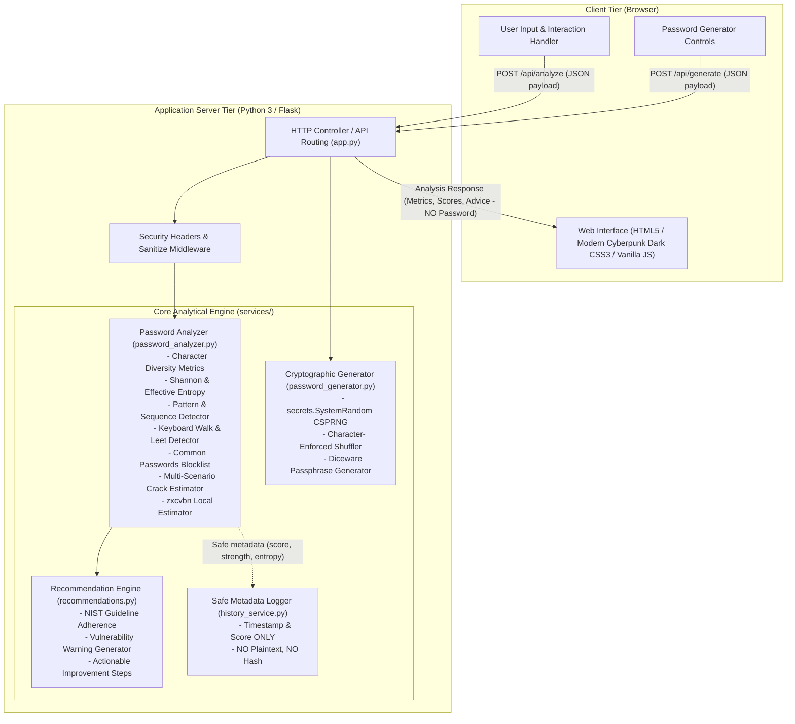
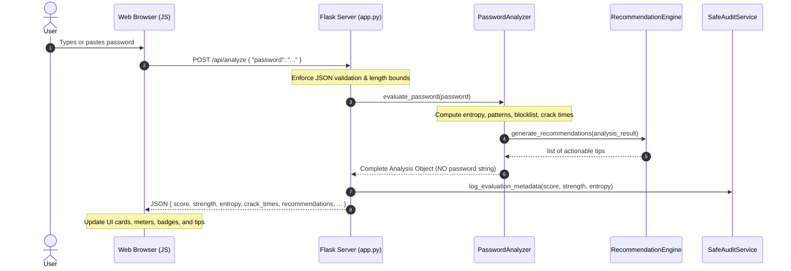

# System Architecture & Technical Design
## Advanced Password Strength Analyzer and Security Recommendation System

### 1. Architectural Philosophy and Design Principles

The **Advanced Password Strength Analyzer and Security Recommendation System** is built on the fundamental principle of **Zero-Knowledge Privacy-Preserving Security Assessment**. Unlike traditional web utilities that inadvertently transmit, cache, or log credential data, this application guarantees that:

1. **Zero Data Retention:** Password strings exist strictly in volatile process memory for the sub-millisecond duration required to compute analytical metrics, after which they are immediately discarded.
2. **Strict No-Logging Policy:** Application loggers, HTTP access logs, query parameters, error handlers, and storage layers are explicitly decoupled from user input strings.
3. **NIST SP 800-63B Alignment:** The analytical engine embraces modern security recommendations established in the NIST Digital Identity Guidelines (SP 800-63B-4), emphasizing length, entropy, and resistance to automated attacks over arbitrary composition rules (such as forcing arbitrary special characters or frequent forced rotation).
4. **Defense-in-Depth Web Architecture:** Flask application is configured with secure HTTP headers (CSP, X-Content-Type-Options, X-Frame-Options), strict input validation, rate limiting considerations, and sanitization.

---

### 2. High-Level Architecture Diagram

---

### 3. Detailed Component Breakdown

#### A. Presentation Tier (Frontend)
- **`templates/base.html` & `templates/index.html`**: Semantic HTML5 structure providing an accessible, responsive dashboard layout with modular cards for analyzer, live meters, granular metrics, recommendations, generator, and educational panels.
- **`static/css/style.css`**: Cyber-defense themed UI utilizing modern CSS custom properties (variables), Flexbox/Grid layouts, accessible contrast ratios, dynamic strength meter animations, and responsive mobile breakpoints.
- **`static/js/app.js`**: Lightweight asynchronous JavaScript managing input events, dynamic DOM manipulation, clipboard interaction, password visibility toggling, and asynchronous REST communication (`fetch` API).

#### B. Controller & Routing Tier (`app.py`)
- Provides clean REST endpoints:
  - `GET /`: Renders the cybersecurity dashboard.
  - `POST /api/analyze`: Ingests input string via JSON body, invokes analytical pipeline, returns JSON analysis (strictly suppressing input password reflection).
  - `POST /api/generate`: Ingests length and character criteria, produces cryptographically secure pseudorandom output via `secrets`.
  - `GET /api/history`: Returns anonymized audit records (timestamps, strength grades, scores) without any credential data.
  - `POST /api/history/clear`: Clears the session audit log.
- Enforces HTTP response headers:
  - `Content-Security-Policy` (CSP)
  - `X-Content-Type-Options: nosniff`
  - `X-Frame-Options: DENY`
  - `Referrer-Policy: no-referrer`
  - `Cache-Control: no-store, no-cache, must-revalidate`

#### C. Core Analytical Engine (`services/password_analyzer.py`)
1. **Character Set Diversity:** Computes counts and booleans for lowercase, uppercase, digits, symbols, and whitespace.
2. **Shannon Entropy & Pool Cardinality:**
   $$\text{Pool Size } R = \sum (\text{character classes present})$$
   $$\text{Theoretical Entropy } H = L \times \log_2(R)$$
   $$\text{Effective Entropy } H_{\text{eff}} = H - \text{Pattern Penalties}$$
3. **Sequential Pattern Detection:** Detects ascending and descending sequences (e.g., `abc`, `cba`, `12345`, `9876`).
4. **Repetition & Run-Length Encoding:** Detects repeated characters (e.g., `aaa`), duplicate frequencies, and contiguous repeats.
5. **Keyboard Walking Sequences:** Checks against QWERTY row walks (`qwerty`, `asdfgh`, `zxcvbn`) and column walks (`1qaz`, `2wsx`).
6. **Leet-Speak & Substitution Normalization:** Maps characters like `@ -> a`, `3 -> e`, `0 -> o`, `1 -> l/i`, `$ -> s` prior to dictionary matching.
7. **Local Common Password & Wordlist Blocklist:** Pre-compiled hash set of high-frequency breached and default passwords for sub-millisecond offline lookup without third-party network egress.
8. **Crack-Time Simulation Engine:** Evaluates computational feasibility across 4 attacker models:
   - Online Throttled (100 attempts / hour)
   - Online Unthrottled (10 attempts / second)
   - Offline Slow Hash (bcrypt / Argon2, 10,000 attempts / second)
   - Offline Fast Hash (MD5 / NTLM on modern GPU rig, 100,000,000,000 attempts / second)
9. **Hybrid Scoring Engine:** Blends mathematical entropy, deterministic pattern deductions, and `zxcvbn` estimation to produce a normalized score ($0 - 100$) mapped to 5 strength levels:
   - $0 \le \text{Score} \le 19$: **Very Weak**
   - $20 \le \text{Score} \le 39$: **Weak**
   - $40 \le \text{Score} \le 59$: **Moderate**
   - $60 \le \text{Score} \le 79$: **Strong**
   - $80 \le \text{Score} \le 100$: **Very Strong**

#### D. Recommendation Engine (`services/recommendations.py`)
Translates granular vulnerability flags into prioritized human-readable advice:
- Length thresholds (<12 chars, <16 chars).
- Pattern warnings (keyboard walks, dictionary words, leet-speak substitutions, numerical sequences).
- NIST best practices: encouraging multi-word passphrases instead of arbitrary symbolic substitutions.
- Defensive operational advice: Password Managers and Multi-Factor Authentication (MFA).

#### E. Cryptographically Secure Generator (`services/password_generator.py`)
- Employs Python's built-in `secrets` module (utilizing OS kernel entropy source `CryptGenRandom` / `getrandom`).
- Implements rejection sampling and the Fisher-Yates shuffle algorithm to ensure non-predictable distribution while guaranteeing at least one character from each requested category.
- Diceware passphrase mode: Generates memorable, high-entropy 4-to-6 word phrases from an embedded curated wordlist.

#### F. Non-Sensitive Metadata Audit Service (`services/history_service.py`)
- Maintains an in-memory / SQLite audit trail of user evaluation events.
- **Strict Data Schema:** `id`, `timestamp_utc`, `score`, `strength_label`, `length`, `entropy_bits`.
- Plaintext passwords, password hashes, salt values, and user identities are completely omitted by design.

---

### 4. Sequence & Data Flow

---

### 5. Architectural Quality Attributes

| Attribute | Implementation Strategy |
|---|---|
| **Confidentiality** | Zero persistence, no logging, no external API requests, no reflection in response body. |
| **Availability & Performance** | Pure in-memory evaluations executed in $< 5 \text{ ms}$; no database bottlenecks. |
| **Maintainability** | Clean separation of concerns between analyzer, generator, recommendations, and routes. |
| **Testability** | Deterministic unit tests covering boundary conditions, attack patterns, and generator entropy. |
| **Compliance** | Directly aligns with NIST SP 800-63B guidelines and OWASP ASVS Password Security requirements. |
